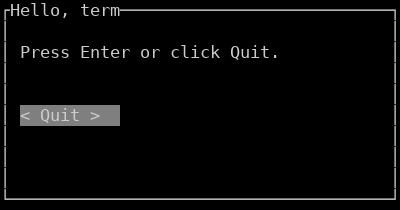

Term - Terminal window and user interface library for C++
=========================================================

Term is (yet another) library for creating windowed user interfaces on terminals.

[](https://www.apache.org/licenses/LICENSE-2.0.txt)
[](https://www.apache.org/licenses/LICENSE-2.0.txt)
[](https://github.com/jwezel/term/actions/workflows/ci-meson.yml)

Table of contents
-----------------

* [Introduction](#introduction)
* [Features](#features)
* [Usage](#usage)
* [Known issues and limitations](#known-issues-and-limitations)
* [Getting help](#getting-help)
* [Contributing](#contributing)
* [License](#license)
* [Authors and history](#authors-and-history)
* [Acknowledgments](#acknowledgments)
* [Full manual and API reference](#documentation)


Introduction
------------

The library is functionally divided into two domains:

- Creating and maintaining windows on terminals
- Creating user interfaces in windows

Both parts can be used together, or separately, because they share the same
mechanism for maintaining rectangles on surfaces and their output mechanism can
easily be adapted to any device. For example, the "output device" for the user
interface part is a terminal window.


Features
--------

- Overlapping windows
- Rich color and attribute support
- Box and line drawing with automatic interpolation
- Mouse support
- Auto-expanding and auto-contracting desktop
- Weighted, fit-to-content, and aligned box layouts


Usage
-----

Install Python 3, Conan 2, Meson, Ninja, and a C++23 compiler. From a checkout, install the dependencies and build the
quick-start program:

```sh
python3 -m pip install -r requirements.txt
conan profile detect
conan install packages --build=missing
PKG_CONFIG_PATH=packages meson setup build
```

The small program below opens a window. Press Enter or click **Quit** to exit. It is compiled as the `quick_start`
Meson target, so the README teaser is checked by the normal build.

```sh
meson compile -C build quick_start
./build/quick_start
```

```cpp
#include <term/geometry.hh>
#include <term/term.hh>
#include <term/text.hh>
#include <ui/button.hh>
#include <ui/label.hh>
#include <ui/ui.hh>
#include <ui/window.hh>

int main() {
  jwezel::Terminal terminal;
  jwezel::ui::Ui ui{terminal};
  jwezel::ui::Window window{ui, jwezel::Space, jwezel::Rectangle{0, 0, 40, 10}, jwezel::Text{"Hello, term"}};
  jwezel::ui::Label hint{window, jwezel::Rectangle{2, 2, 36, 3}, jwezel::Text{"Press Enter or click Quit."}};
  jwezel::ui::Button quit{window, jwezel::Rectangle{2, 5, 12, 6}, jwezel::Text{"Quit"}};
  quit.onPress([&ui](const jwezel::ui::Element &, const jwezel::Event &) {
    ui.stop();
    return true;
  });
  ui.run();
}
```



The [tutorial](docs/tutorial.md) builds on this example with layouts, typed events, and text input.

Documentation
-------------

The [manual and API reference](docs/index.md) cover architecture, concepts, tutorials, and the public C++ headers.
With Doxygen installed, generate the browsable HTML version using `ninja -C build docs`; open `build/html/index.html`.


Known issues and limitations
----------------------------

At the moment the terminal output layer is only issuing control sequences for ANSI terminals, such as xterm.


Getting help
------------

Report bugs and request features in the [GitHub issue tracker](https://github.com/jwezel/term/issues). Include your compiler, terminal, and the steps needed to reproduce the problem.


Contributing
------------

Contributions are welcome as GitHub pull requests. Please keep changes focused, add or update tests and public-header documentation where appropriate, and run the normal and release test suites before submitting.


License
-------

Licensed under the Apache License, Version 2.0 (the "License"); you may not use
this software except in compliance with the License. You may obtain a copy of the
License at

http://www.apache.org/licenses/LICENSE-2.0

Unless required by applicable law or agreed to in writing, software distributed
under the License is distributed on an "AS IS" BASIS, WITHOUT WARRANTIES OR
CONDITIONS OF ANY KIND, either express or implied. See the License for the
specific language governing permissions and limitations under the License.


Authors and history
-------------------

- Johnny Wezel (http://github.com/jwezel)


Acknowledgments
---------------

* https://github.com/mhucka/readmine
